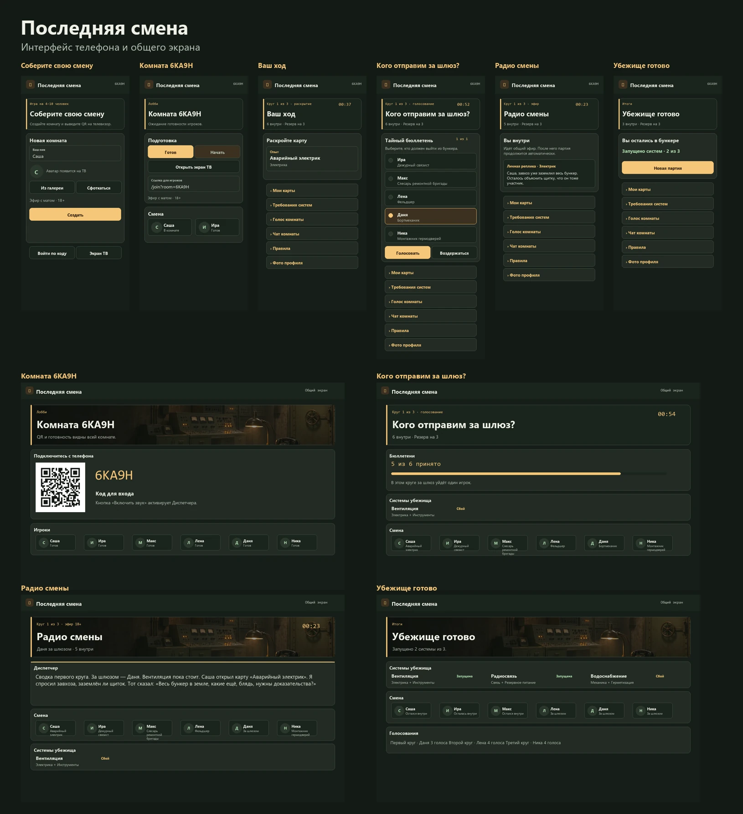

# Последняя смена

Браузерная версия для 4–10 телефонов и одного экрана ТВ. Все начинают в аварийном убежище и голосуют, кого отправить за шлюз. Организатор играет наравне со всеми.

[Правила и ТЗ](docs/game-spec.md) · [Отчёт о тестах](TEST-REPORT.md) · [Макеты в Figma](https://www.figma.com/design/AXBFjERADn17WJGxQZmpy9/last-shift-interface) · [Файл Sketch](docs/last-shift-interface.sketch)



## Запуск

В Windows можно открыть `START.cmd`. Для запуска из терминала откройте папку проекта и выполните команду ниже. Требуется Node.js 20 или новее. Игровой сервер запускается без установки зависимостей.

```powershell
git clone https://github.com/solid0075/bunker.git
cd bunker
node server.mjs
```

1. Откройте адрес, напечатанный в строке «По Wi-Fi», на телефоне организатора и создайте комнату. Компьютер, телефоны и телевизор должны иметь доступ к одной локальной сети.
2. На телевизоре откройте тот же адрес, выберите «Экран ТВ» и введите код комнаты. Можно открыть экран ТВ на ноутбуке и подключить ноутбук к телевизору. Нажмите «Включить звук».
3. Остальные сканируют QR или вводят код, выбирают ник и при желании фото. Когда все нажмут «Готов», организатор запускает партию со своего телефона.

В партии работают вступление с пропуском, три круга, тайные бюллетени, переголосование, изгнания, «Радио смены» и финал. Эфир с матом включается в лобби. На телефоне после сводки появляется личная шутка про открытую карту. Объявления доступны текстом. По умолчанию озвучку даёт браузер телевизора или подключённого компьютера. Для гарантированного русского голоса можно подключить Piper на сервере.

## Диспетчер OpenAI

Без настроек сервер использует готовые реплики и авторские шутки. Чтобы добавить реплики модели, задайте на сервере `OPENAI_API_KEY` и `OPENAI_MODEL`, затем перезапустите процесс. Ключ читает только сервер. Модель получает обезличенные игровые факты. Правила, результаты и смену фаз определяет сервер. Если API задерживается или не отвечает, работает готовая сводка.

Общие сведения о настройке API есть в [официальном руководстве OpenAI](https://developers.openai.com/api/docs/quickstart).

## Русская озвучка на сервере

Piper запускается отдельным локальным сервисом. Загрузите русский голос, запустите сервис на `127.0.0.1:4191`, затем задайте для игры `SHIFT_SPEECH_URL=http://127.0.0.1:4191`. Браузер проиграет аудиофайл через игровой сервер. «Пропустить правила» прерывает запись на ТВ. При недоступности сервиса браузер использует собственный синтез и показывает текст.

```powershell
python -m pip install "piper-tts[http]==1.8.0"
python -m piper.download_voices ru_RU-dmitri-medium
python -m piper.http_server -m ru_RU-dmitri-medium --host 127.0.0.1 --port 4191
```

[Документация Piper](https://github.com/OHF-Voice/piper1-gpl/blob/main/docs/API_HTTP.md) · [Паспорт голоса Dmitri](https://huggingface.co/rhasspy/piper-voices/blob/main/ru/ru_RU/dmitri/medium/MODEL_CARD)

## Хранение и размещение

Комнаты, гостевые сессии и уменьшенные аватары записываются в `.last-shift-data`. Путь можно переопределить через `SHIFT_DATA_DIR`. После перезапуска сервер восстанавливает комнату, карты, подтверждённые бюллетени и оставшееся время фазы. Файлы удаляются после четырёх часов без активности. Один процесс Node.js обслуживает одну папку данных.

Для размещения на своём сервере направьте HTTPS-прокси на процесс Node.js, задайте `SHIFT_PUBLIC_URL` с внешним адресом комнаты и сохраните папку данных на постоянном диске. Поток событий должен проходить без буферизации. `SHIFT_PORT` меняет порт, по умолчанию 4173. При запуске за прокси можно привязать Node.js к локальному интерфейсу через `SHIFT_HOST=127.0.0.1`.

Серверная логика партии находится в `game.mjs`, сетевые маршруты и доступ к озвучке — в `server.mjs`, хранение комнат — в `store.mjs`. В `public/` находятся экраны телефона и ТВ, а также клиент голосовой связи. Папки `test/` и `checks/` содержат сценарии проверки.

## Дистанционный голос

На телефоне откройте «Голос комнаты» и подключите микрофон. Звук идёт по WebRTC между игроками. Видеопоток и запись разговора в игре отсутствуют. Диспетчера слышно через общий экран. Текстовый чат доступен рядом с голосом.

Доступ к микрофону требует защищённого браузерного контекста. Для игры через интернет используйте HTTPS и настройте собственный TURN в `SHIFT_ICE_SERVERS`, если у игроков разные сети. Переменная принимает JSON-массив с объектами `urls`, при необходимости `username` и `credential`. Для TURN предпочтительны ограниченные по сроку учётные данные. [Настройка WebRTC и ICE](https://webrtc.org/getting-started/peer-connections) · [Доступ к микрофону](https://developer.mozilla.org/en-US/docs/Web/API/MediaDevices/getUserMedia)

## Проверка

```powershell
npm test
npm run test:api
npm run test:browser
npm run test:voice
```

Последние две команды используют Playwright как инструмент проверки, а сама игра в нём не нуждается. `SHIFT_TEST_ENGINE` выбирает `chromium`, `firefox` или `webkit` для `test:browser`. `SHIFT_TEST_BROWSER` позволяет указать путь к Chrome или Edge. `test:voice` запускает Chromium. [Установка браузеров Playwright](https://playwright.dev/docs/browsers#install-browsers)

Для браузерного прогона из свежего клона установите тестовую зависимость и браузеры:

```powershell
npm install --no-save --package-lock=false playwright
npx playwright install chromium firefox webkit
npm run test:browser
npm run test:voice
```

Чтобы проверить воспроизведение WAV от запущенного Piper, задайте `SHIFT_TEST_SPEECH_URL=http://127.0.0.1:4191` перед `npm run test:browser`.

## Иллюстрация

`public/dispatch.webp` создана встроенным генератором. Бриф для изображения — фотореалистичный широкоэкранный кадр пустой подземной диспетчерской после отключения света, с бетоном, оливковой сталью, аналоговыми пультами, янтарными лампами и гермодверью справа. Левая часть затемнена под интерфейс, графика без надписей и логотипов.

## Интерфейс для портфолио

`docs/last-shift-interface.sketch` содержит обложку, 23 состояния телефона, 10 экранов телевизора и 12 редактируемых компонентов. В архиве есть текстовые слои, оригинальная иллюстрация, палитра и связи основных переходов. Экранные данные демонстрационные.

Чтобы создать свою редактируемую копию, откройте **Drafts** в Figma и перетащите туда `last-shift-interface.sketch`. Figma создаст файл Design. [Справка Figma по импорту](https://help.figma.com/hc/en-us/articles/360040514273-Import-Sketch-files)
